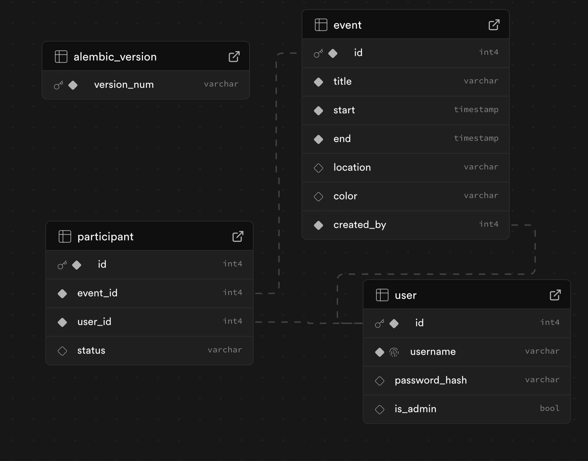

# Event Management System v5

    

## 概要 / Overview
このアプリケーションは、イベントの作成、管理、参加者の追跡を行うためのフルスタックWebツールです。
Google Sheets API との連携機能を持ち、直感的なカレンダーインターフェース（FullCalendar.js）を提供します。

This is a full-stack event management tool with Google Sheets API integration and an interactive calendar interface (FullCalendar.js).

## 技術スタック / Tech Stack
- **Backend**: Python 3.13 / Flask 3.1
- **Database**: PostgreSQL 17 (Supabase Managed) / SQLAlchemy 2.0
- **Frontend**: HTML5, CSS3, JavaScript (Vanilla), FullCalendar.js
- **Infra/Deployment**: Docker, Docker Compose, Oracle Cloud Infrastructure (VM)
- **Localization**: Flask-Babel (Japanese / English)
- **API Integration**: Google Sheets API

## 主な機能 / Features
- **Authentication**: ユーザー認証（Flask-Login）
- **Event Management**: カレンダー上でのイベントCRUD（作成・編集・削除）
- **Participant Tracking**: 参加ステータス管理
- **Google Sheets Sync**: スプレッドシートからのイベント一括取り込み
- **Admin Dashboard**: 管理者によるユーザー・イベント管理
- **Responsive Design**: モバイル・デスクトップ両対応

## データベース構造 / Database Schema


## デモ用アカウント / Demo Accounts
- **管理者 (Admin)**: `admin` / `admin_password`
- **一般ユーザー (User)**: `sample` / `sample`

## CI / デプロイ / CI & Deployment
GitHub Actions (`.github/workflows/ci.yml`) は `main` への push と Pull Request で pytest を実行します。自動デプロイは行いません。

### Oracle Cloud VM へのデプロイ（手動）
1. VM に Docker / Docker Compose / git をインストールする
2. 任意のディレクトリにリポジトリを clone する
3. そのディレクトリに `.env` を作成し、`DATABASE_URL`（Supabase URI）と `SECRET_KEY` を設定する
4. `git pull origin main` の後、`docker compose up -d --build --remove-orphans` で起動する（`db` サービスは `local` プロファイルなので起動せず、`web` のみ起動します。コンテナ起動時に `flask db upgrade` が実行されます）

> 以前の compose で `db` コンテナが起動済みの場合は、先に `docker compose down` するか、`--remove-orphans` 付きで `up` してください。

> `docker-compose.yml` はポートを `127.0.0.1` にバインドしているため、外部からアクセスする場合は VM 上のリバースプロキシと OCI のセキュリティリスト（Ingress ルール）の設定が必要です。

## ローカル開発環境のセットアップ / Local Setup
```bash
# 1. Clone
git clone https://github.com/takuaki-taku/event_manager_v5.git
cd event_manager_v5

# 2. Environment Variables (.env)
# COMPOSE_PROFILES=local を入れると db も一緒に起動します
#   COMPOSE_PROFILES=local
#   DATABASE_URL=postgresql://postgres:password@db:5432/postgres
#   SECRET_KEY=<任意の値>

# 3. Docker Start（db + web が起動）
docker compose up --build
```

`COMPOSE_PROFILES=local` を省略したい場合は、毎回 `docker compose --profile local up --build` としても同じです。本番（Oracle Cloud VM）の `.env` には `COMPOSE_PROFILES` を設定しないため、`docker compose up -d --build` で `web` だけが起動します。

## ライセンス / License
MIT License
