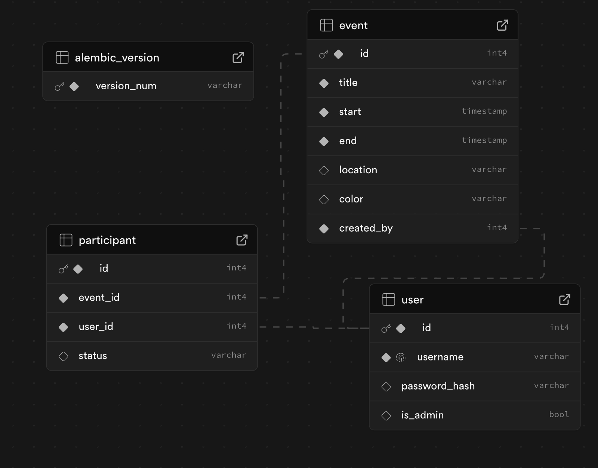

# Event Management System v5

    

## 概要 / Overview
このアプリケーションは、イベントの作成、管理、参加者の追跡を行うためのフルスタックWebツールです。
Google Sheets API との連携機能を持ち、直感的なカレンダーインターフェース（FullCalendar.js）を提供します。

This is a full-stack event management tool with Google Sheets API integration and an interactive calendar interface (FullCalendar.js).

## 技術スタック / Tech Stack
- **Backend**: Python 3.13 / Flask 3.1
- **Database**: PostgreSQL 17 (Supabase Managed) / SQLAlchemy 2.0
- **Frontend**: HTML5, CSS3, JavaScript (Vanilla), FullCalendar.js
- **Infra/Deployment**: Docker, docker-compose, Render
- **Localization**: Flask-Babel (Japanese / English)
- **API Integration**: Google Sheets API

## 主な機能 / Features
- **Authentication**: ユーザー認証（Flask-Login）
- **Event Management**: カレンダー上でのイベントCRUD（作成・編集・削除）
- **Participant Tracking**: 参加ステータス管理
- **Google Sheets Sync**: スプレッドシートからのイベント一括取り込み
- **Admin Dashboard**: 管理者によるユーザー・イベント管理
- **Responsive Design**: モバイル・デスクトップ両対応

## データベース構造 / Database Schema


## デモ用アカウント / Demo Accounts
- **管理者 (Admin)**: `admin` / `admin_password`
- **一般ユーザー (User)**: `sample` / `sample`

## クラウドデプロイ / Cloud Deployment
本リポジトリは Render に最適化されています。以下の手順でデプロイ可能です。
1. GitHub リポジトリを Render に連携。
2. 環境変数 `DATABASE_URL` (Supabase URI) と `SECRET_KEY` を設定。
3. `Dockerfile` に基づいて自動ビルド・デプロイされます。

## ローカル開発環境のセットアップ / Local Setup
```bash
# 1. Clone
git clone https://github.com/takuaki-taku/event_manager_v5.git
cd event_manager_v5

# 2. Environment Variables (.env)
# Create .env file with DATABASE_URL and SECRET_KEY

# 3. Docker Start
docker-compose up --build
```

## ライセンス / License
MIT License
